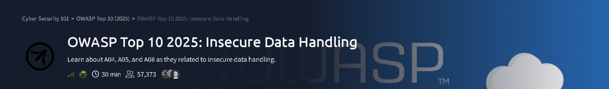
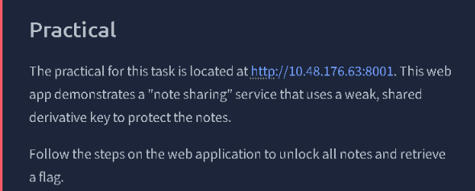
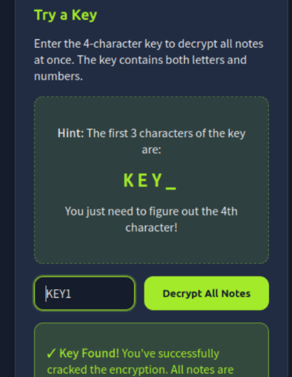
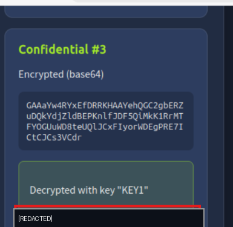
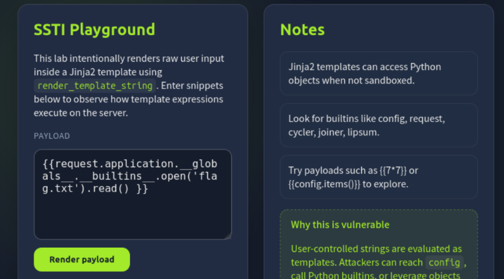
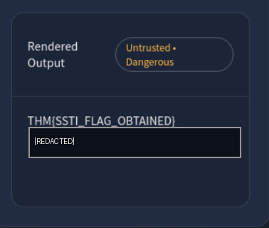
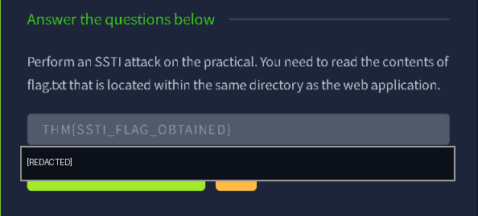
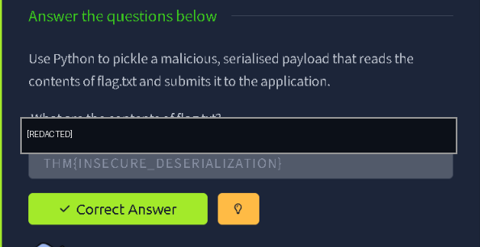

# OWASP Top 10 2025: Insecure Data Handling — TryHackMe Walkthrough

> **Scope:** Authorized TryHackMe room/lab environment only. This write-up documents the successful path shown in the supplied screenshots. Flag strings are intentionally redacted; the exploitation techniques and non-secret answers remain visible.

## Room overview

The room covers insecure data handling through three practical exercises: weak cryptographic key derivation, server-side template injection (SSTI), and insecure deserialization.



## 1. Recon: identify the practical target

The room's practical note-sharing application is hosted at:

```text
http://10.48.176.63:8001
```

The application protects shared notes with a weak, shared derivative key. The goal is to recover the key, decrypt the notes, and identify the note containing the first flag.



## 2. A04 — Cryptographic failures: recover the weak key

The key-entry panel gives a four-character format and reveals the first three characters:

```text
KEY_
```

The final character is `1`, so the recovered key is:

```text
KEY1
```

Enter `KEY1` in the key field and choose **Decrypt All Notes**. The application confirms that the key is valid and decrypts the notes.



One decrypted note contains the flag. Its value is redacted in the evidence image below.



**Finding:** A predictable, shared key makes the confidentiality of every note dependent on a trivially guessable value. Use independently generated, high-entropy keys and a modern authenticated-encryption scheme; do not derive a shared secret from a short hint.

## 3. A05 — Injection: exploit server-side template injection

The next practical is an SSTI playground. Its description states that raw user input is passed to Jinja2's `render_template_string`, and that Python objects are accessible because the template environment is not sandboxed.

The successful payload shown in the lab reads `flag.txt` through the Flask request application's globals:

```jinja2
{{request.application.__globals__.__builtins__.open('flag.txt').read()}}
```

Paste the payload into the playground's payload field and click **Render payload**. The rendered output contains the file contents; the flag value is redacted below.





The room accepts the recovered value in its answer field (redacted in the evidence capture).



**Finding:** Treating user-controlled text as a template allows server-side expression evaluation. Never pass untrusted input to `render_template_string`. Prefer fixed templates with user input supplied only as data, and keep template execution sandboxed.

## 4. A08 — Insecure deserialization: abuse Python pickle

The final practical asks for a malicious serialized Python payload that reads `flag.txt` and submits its contents to the application.

Python's `pickle` format is unsafe for untrusted data: deserializing a crafted pickle can invoke attacker-controlled callables. In a controlled lab, a payload can use a reduction callable to read the local flag file when the application unpickles it.

The key workflow is:

1. Construct a pickle object whose reduction invokes a file-reading operation for `flag.txt`.
2. Serialize the object with Python's `pickle` module.
3. Submit the serialized bytes through the practical application's provided input path.
4. Read the returned file contents and enter the value in the room's answer field.

The supplied evidence confirms the task was accepted; the flag value is redacted.



**Finding:** Never unpickle data from an untrusted source. Use a data-only format such as JSON where possible, validate schemas and types, and authenticate data before processing it. Authentication does not make arbitrary pickle safe if the signing key or trust boundary is compromised.

## 5. Key takeaways

| OWASP category | Lab weakness | Core lesson |
|---|---|---|
| A04 — Cryptographic Failures | Predictable shared note key | Use strong, unique keys and authenticated encryption. |
| A05 — Injection | User input evaluated as a Jinja2 template | Keep untrusted input as data, never executable template source. |
| A08 — Software and Data Integrity Failures | Unsafe Python pickle deserialization | Do not deserialize untrusted pickle data. |

## Completion

All three practical tasks shown in the supplied screenshots are marked as correct. Secret flag values have been deliberately removed from this public-facing write-up.

---

### Evidence note

The material supplied for this write-up consisted of eight screenshots rather than a video file. The images above are focused crops of those screenshots; no additional recording frames were available.
